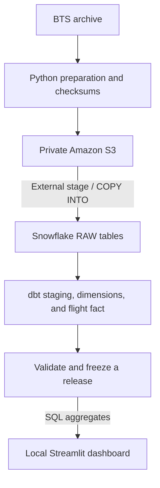

# Airline Delay Intelligence

A data engineering project that transforms historical U.S. airline records into a
Snowflake warehouse and an interactive reliability dashboard. Built with **Python,
Amazon S3, Snowflake, dbt Core, Streamlit, and Terraform**.

The January 2025 dataset contains **599,013 reported scheduled operation rows**,
including **24,732 Denver departures**. The focus is both useful analysis and a
reproducible pipeline: preserving source data, handling corrections without double
counting, and keeping incomplete refreshes out of the dashboard.

## Analytics

Explore arrival punctuality, cancellations, diversions, and departure delays by
marketing carrier, origin airport, directional route, weekday, and scheduled local
departure hour. Date, carrier, and airport filters support focused comparisons;
mean, median, and p90 show how typical delays differ from the long tail.

The dashboard helps investigate questions such as:

- Which carriers combine punctual arrivals with fewer cancellations?
- Which airports and scheduled hours have higher departure-delay rates?
- How does reliability differ between a route and its reverse direction?

Comparisons include eligible counts and small-group warnings. They describe
historical performance—not predictions, passenger impact, or proof of causation.

## Architecture



Official [BTS Marketing Carrier On-Time Performance](https://www.transtats.bts.gov/)
archives are imported explicitly and prepared locally. All 119 source fields are
preserved alongside file and row fingerprints. Snowflake loads the prepared data
from private S3; each accepted artifact has its own RAW table.

Five dbt models provide staging, date/airport/carrier dimensions, and a flight fact.
Each fact represents one selected source row, retaining marketing and operating
carrier identities—not a passenger journey or a guaranteed unique aircraft movement.
Snowflake calculates filtered rates and percentiles; the dashboard receives
aggregates rather than downloading the full flight dataset.

### Key design choices

- **Traceable, repeatable inputs.** Select one accepted source version per month.
  Replays reuse compatible results; corrections replace a month's contribution
  without overwriting its history or adding it twice.
- **Safe publication.** Build in isolation, clone and validate the completed result,
  then atomically select the release. Failed updates leave the previous release
  available, and each dashboard render uses one consistent release.
- **Separated access.** Builder, publisher, and reader use distinct service identities.
  S3 access is scoped, and the dashboard reads named released views only.
- **Tested behavior.** Data checks reconcile source values, keys, joins, and metric
  eligibility. Integration scenarios exercise real Snowflake concurrency, failure
  handling, and controlled corrections alongside offline application tests.

## Run locally

Requires **Python 3.12**, [uv](https://docs.astral.sh/uv/), and access to the configured
Snowflake reader identity and a published release. Data and credentials are not
included; dashboard queries use Snowflake compute.

```bash
uv sync --locked --extra analytics
uv run --extra analytics streamlit run app.py --server.address 127.0.0.1
```

Run the offline checks separately; live integration tests are opt-in:

```bash
uv run --extra analytics python -m unittest discover -s tests -v
uv run --extra analytics ruff check .
```

## Code layout

| Path | Purpose |
| --- | --- |
| [`src/airline_warehouse/`](src/airline_warehouse/) | Preparation, loading, refresh, publication, analytical SQL, and dashboard |
| [`dbt/`](dbt/) | Warehouse models, data tests, and transformation lineage |
| [`infra/ingestion/`](infra/ingestion/) | Terraform for private S3 storage and scoped IAM access |
| [`sql/`](sql/) | Snowflake setup and publication-control schema |
| [`tests/`](tests/) | Offline and explicitly enabled integration tests |
