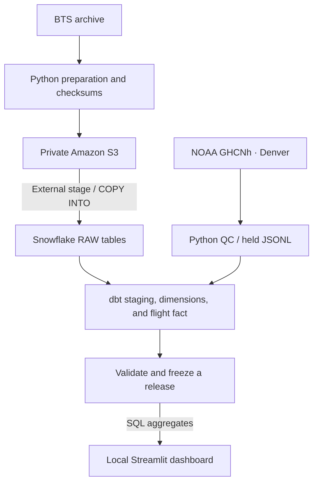

# Airline Delay Intelligence

A data engineering project that transforms historical U.S. airline records into a
Snowflake warehouse and an interactive reliability dashboard. Built with **Python,
Amazon S3, Snowflake, dbt Core, Streamlit, Terraform, ECS/Fargate and Step Functions**.

The January 2023–December 2025 baseline contains **22,562,477 reported scheduled
operation rows**, with weather context for **930,445 Denver departures across
2023–2025** using NOAA GHCNh.
The focus is both useful analysis and a
reproducible pipeline: preserving source data, handling corrections without double
counting, and keeping incomplete refreshes out of the dashboard.

The dashboard has four investigations: Network & carriers, Time & routes,
Disruption & recovery, and DEN weather. Source-to-reader reconciliation, replay,
controlled corrections and failure recovery have been exercised. The full-period
Denver extension and provenance fixes are recorded in [weather evidence](docs/weather-2023-2025.md).
The separately qualified ECS/Step Functions path uses isolated targets and the
original January ISD weather transport; the newer GHCNh extension was built locally
using shared pipeline logic. Code delivery does not initiate a data refresh.

**Runtime status (2026-11-14):** Local servers are stopped and AWS execution/image
resources have been removed under an approved teardown. Some resources remain
pending owner permissions, including the Snowflake database and suspended warehouse,
two secrets and the project VPC endpoint. The Terraform state bucket is retained
until those dependencies are removed. See the exact [resource status](docs/resource-lifecycle.md).
The repository is not a hosted dashboard or a self-contained copy of its data.

See the [acceptance map](docs/acceptance.md), [delivery evidence](docs/delivery.md),
[cloud qualification](docs/cloud-jobs.md), [baseline evidence](docs/baseline.md),
[dashboard guide](docs/dashboard-guide.md) and [architecture walkthrough](docs/presentation.md).
Recorded security findings and provider-coverage exceptions remain disclosed.

## Analytics

Explore arrival punctuality, cancellations, diversions, and departure delays by
marketing carrier, origin airport, directional route, weekday, and scheduled local
departure hour. Date, carrier, and airport filters support focused comparisons;
mean, median, and p90 show how typical delays differ from the long tail.

The dashboard helps investigate questions such as:

- Which carriers combine punctual arrivals with fewer cancellations?
- Which airports and scheduled hours have higher departure-delay rates?
- How does reliability differ between a route and its reverse direction?
- How do reported delay allocations and schedule-relative recovery differ?
- What scheduled weather context accompanies Denver departures during 2023–2025?

Comparisons include eligible counts and small-group warnings. They describe
historical performance—not predictions, passenger impact, or proof of causation.

## Architecture



Official [BTS Marketing Carrier On-Time Performance](https://www.transtats.bts.gov/)
archives are imported explicitly and prepared locally. All 119 source fields are
preserved alongside file and row fingerprints. Snowflake loads the prepared data
from private S3; each accepted artifact has its own RAW table.

Five core dbt models provide staging, date/airport/carrier dimensions, and a flight fact;
two additional models preserve weather observations and matched scheduled-flight context.
Each fact represents one selected source row, retaining marketing and operating
carrier identities—not a passenger journey or a guaranteed unique aircraft movement.
Snowflake calculates filtered rates and percentiles; the dashboard receives
aggregates rather than downloading the full flight dataset.

### Key design choices

- **Traceable, repeatable inputs.** Select one accepted source version per month.
  Replays reuse compatible results; corrections replace a month's contribution
  without overwriting its history or adding it twice.
- **Safe publication.** Build in isolation, clone and validate the completed result,
  then atomically select the release. Failed updates leave the previous release
  available, and each dashboard render uses one consistent release.
- **Separated access.** Builder, publisher, and reader use distinct service identities.
  S3 access is scoped, and the dashboard reads named released views only.
- **Tested behavior.** Data checks reconcile source values, keys, joins, and metric
  eligibility. Integration scenarios exercise real Snowflake concurrency, failure
  handling, and controlled corrections alongside offline application tests.

## Run locally

Requires **Python 3.12**, [uv](https://docs.astral.sh/uv/), and access to the configured
Snowflake reader identity and a published release. Data and credentials are not
included; dashboard queries use Snowflake compute.

The commands below describe application startup, not automatic infrastructure or
data restoration. The [resource lifecycle status](docs/resource-lifecycle.md) must be
resolved before using a live environment. Do not apply retained Terraform state or
re-enable deployment to recreate resources without a reviewed provisioning plan.

```bash
uv sync --locked --extra analytics
uv run --extra analytics streamlit run app.py --server.address 127.0.0.1
```

Run the offline checks separately; live integration tests are opt-in:

```bash
uv run --extra analytics python -m unittest discover -s tests -v
uv run --extra analytics ruff check .
```

## Code layout

| Path | Purpose |
| --- | --- |
| [`src/airline_warehouse/`](src/airline_warehouse/) | Preparation, loading, refresh, publication, analytical SQL, and dashboard |
| [`dbt/`](dbt/) | Warehouse models, data tests, and transformation lineage |
| [`infra/ingestion/`](infra/ingestion/) | Terraform for private S3 storage and scoped IAM access |
| [`infra/jobs/`](infra/jobs/) | Separate immutable task/workflow release state and promotion review |
| [`sql/`](sql/) | Snowflake setup and publication-control schema |
| [`tests/`](tests/) | Offline and explicitly enabled integration tests |
