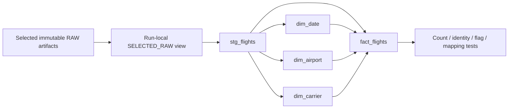

# January models and local analytics — tickets05–10

**Status: 05–10 implemented and live-verified 2026-10-28; awaiting owner batch review.**
Publisher/reader identities authenticate independently. January is published and
the local dashboard reads released views only. Qualification is described below;
this is not final36-month project acceptance or authorization for ticket11.
Approved scope is January2025 plus isolated synthetic fixtures, not the final36months.
Use the existing [ingestion runbook](ingestion.md) for the accepted raw artifact.

## Local setup and commands

```bash
uv sync --locked --extra load --extra analytics
uv run --extra analytics dbt parse --project-dir dbt --profiles-dir dbt --no-partial-parse
uv run --extra analytics python -m unittest discover -s tests -v
uv run --extra analytics ruff check .
uv run --extra analytics ruff format --check .

# A new output directory is required. This creates/tests a candidate, never publishes.
uv run --extra analytics airline build --artifact /private/path/to/january-artifact \
  --output /private/path/to/new-candidate --budget-state /private/path/to/batch-budget.json \
  --funding-verified
```

The tested locked set is dbt Core1.12.6, Snowflake adapter1.12.4, connector4.8.1 and
Streamlit1.66.1 on Python3.12. No dbt Cloud/Fusion service, CI or global tool install.
The1.11 adapter's stale certificate upper bound was rejected rather than downgrade TLS.
Core includes its own parser dependency; this is not a separate Fusion execution path.

The approved batch budget is45minutes cumulative live execution and2additional
observed credits from initial account-monitor usage0.12. It is a stop limit, not a
billing cap: account metering is delayed/shared and storage is separate. Keep the same
budget ledger across continuations; never reset it to bypass a stop. X-Small, acceleration
off, auto-suspend60, statement600/queue60 and short lock timeouts remain unchanged.
Only deliberate commands run work; no watchers, automatic source discovery or scheduling.

## Warehouse build and lineage



`candidate_plan()` rejects multiple artifacts for the same month. `build_candidate()`
creates a new allowlisted `WORK_<24hex>` namespace, checks raw integrity, runs dbt with
two threads and emits `candidate.json` **only after success**. It preserves dbt
`manifest.json`, `run_results.json`, compiled SQL and logs under the private output
directory. No accepted RAW overwrite or natural-key MERGE occurs. Deterministic
critical failures remain unaccepted; timeouts/uncertain results block new live work
in the batch ledger until attended reconciliation of the exact query tag.

Five model tables are explicitly transient in a transient schema with one-day
retention; real SHOW evidence verifies table kinds/retention. Small durable control
metadata will be publisher-owned separately. Staging/fact retain all119 original
source columns plus original lineage and typed analytical fields. Technical flight
key is dataset/source-ZIP-hash/ordinal, not physical-flight uniqueness. Marketer and
operator DOT IDs and source airport sequence/codes/attributes remain on every fact.

Dimensions use stable airport/DOT IDs and deterministic selected-scope display labels;
no generalized SCD2 or current corporate-affiliation replacement. The pinned January
profile found zero airport-sequence, airport-code or DOT-code variants per stable ID.
That is one-month evidence, not a claim that historical changes never occur. Future
baseline/reference qualification remains required; original source attributes are retained.

The primary definitions remain [specification D06](specifications/airline-delay-intelligence.md#d06-metric-and-quality-contracts).
Source flags are never coalesced to successful outcomes. Optional missing delay
indicators remain disclosed exclusions. Rates derive from counts at the requested
filter/group level; exact continuous median/p90 derive from eligible signed values.
The query contract uses double-precision division, avoiding Snowflake's default
six-decimal integer-division scale; only presentation rounds values.

## Independent January evidence

The real fact population is599,013, unchanged by dimension joins. Against an independent
read of the original held archive:

| Measure | Numerator | Denominator |
| --- | ---: | ---: |
| Arrival on-time |469,352|578,957|
| Cancellation |18,740|599,013|
| Diversion |1,316|599,013|
| Departure delay |105,508|580,273|

Signed arrival count578,957, mean4.051249056492969minutes, median−8, exact p90=38.
Carrier10/month1/weekday7/scheduled-hour24/origin-airport352 grouped populations each
reconcile to599,013. DEN's165directional route groups reconcile to24,732. Initial
aggregate latency was about1.08s as the builder; this is not a restricted-reader
dashboard SLA. Actual reader cold/warm measurements await bootstrap.

Live hand-authored fixtures separately verify14/15boundaries,−10/0/14/15/60mean15.8,
median14/p9042, cancellation with departure data, diversion inclusion/exclusion,
missing indicators, zero-denominator N/A, unequal subgroup weighting, ordered routes,
scheduled versus actual crossing-hour cohorts and99/100ranking eligibility. Deliberate
missing required IDs and unknown cancellation flags fail dbt acceptance. Offline
AppTest verifies development labeling, filter→empty→reset behavior; cache identities
include account/database/target/schema/release/query contract/every filter/threshold.

Regression input containing a nonfinite signed delay and zero required airport ID
initially reproduced an acceptance bug in an isolated synthetic candidate. That
diagnostic descriptor was explicitly quarantined/unsealed and never granted or
published. The corrected critical test rejects both rows; the official and nine-row
candidates were then rebuilt successfully under the corrected processing contract.
No invalid-row filtering, source repair or official RAW mutation was used.

The latest official candidate and lineage site are outer
`.scratch/airline-delay-intelligence/batch-05-10/january-build-v3/candidate.json` and
`january-build-v3/dbt/index.html`; `build_run_results.json` preserves original test
results. Docs were generated with `--no-compile --empty-catalog`: lineage/SQL/schema
descriptions are inspectable without warehouse catalog queries, but HTML column
statistics are intentionally absent. Actual table-kind/retention evidence is separate.

## Owner bootstrap — completed; do not broaden the existing builder

The agent cannot CREATE ROLE/USER or transfer CONTROL ownership. The owner executed the rendered
script is outer `.scratch/airline-delay-intelligence/batch-05-10/owner-bootstrap.sql`.
It contains public keys only, rendered from `sql/05_analytics_roles.sql`. In the human
ACCOUNTADMIN worksheet, first confirm accountDC50202/AWS_US_EAST_2, then execute that
script in order. Stop at the first error; inspect existing objects rather than replace
them or blindly rerun CREATE statements.

It creates separate SERVICE users/roles AIRLINE_PUBLISHER and AIRLINE_READER, a
publisher-owned CONTROL schema, project-database schema-creation rights for snapshots,
warehouse/database usage and publisher-only monitor visibility. Reader has no base
table SELECT, write rights or role inheritance. No global MANAGE GRANTS, ACCOUNTADMIN
workload grant, AWS permission changes or existing user/key replacement.

Separate private keys are protected0600 under `~/.snowflake/airline-analytics/`, outside
both repositories; existing key/config is unchanged. Never put keys/passphrases into
SQL, command arguments, Git, scratch notes or logs. No private key was copied into the
rendered script. Exact candidate SELECT/USAGE is granted by its existing builder owner,
not by administrative fallback.07 must revoke development-reader candidate access
before adopting released-only reads and prove actual negative permissions.

## Development dashboard (explicit isolated use only)

```bash
AIRLINE_DEVELOPMENT_CANDIDATE=/private/path/to/candidate.json \
  uv run --extra analytics streamlit run app.py --server.address 127.0.0.1
```

The app uses AIRLINE_READER only, never builder/publisher credentials as fallback.
Project Streamlit configuration binds loopback, disables telemetry and hides exception
details. Only bounded aggregate results (up to500groups), not national flights, enter
pandas. Date/carrier/stable-ID origin/destination filters, reset, explicit applied
summary, counts/exclusions, signed summaries and metric-specific ranking flags are
implemented. Raw-field browsing, exports and public hosting are not implemented.

Development requires the explicit descriptor path and displays UNPUBLISHED. The
serving reader's development candidate grants are revoked when adopting released-only
reads. Default mode resolves the `january` active release through sanitized metadata;
initial failure/unavailability is explicit, never a builder-credential fallback.
Analytical cache TTL900s, filter-options TTL15s; descriptor remains pinned across all
queries within a render. Token validity is rechecked before cached results are used.

## Publication/control and explicit refresh

`sql/07_publication.sql` is a publisher-owned version1 migration. Atomic create-only
CTAS seeds its migration guard. Bootstrap serializes target initialization under that
guard and refuses duplicate target rows. Standard-table PK/UNIQUE is not a lock.
Runtime claim, cancellation, failure retirement, publication and replay retirement
first UPDATE the target guard in an explicit transaction, then read authority and
cardinality in later statements. Every error rolls back the whole transaction.
Standard-table locks may serialize other targets too; no row-lock performance claim.

Execution fence and publication epoch are separate. An uncertain/crashed writer's
claim never expires into automatic takeover. Cancellation sets a flag, not a claim
release. Only terminal synchronous work retires failure authority; publication retires
authority in the same registry/pointer commit. The control tail cannot publish again.
The trusted publisher role can technically mutate its objects: this is not WORM.

Publication creates a new transient `RELEASE_<24hex>` schema and four explicit
transient table clones, without COPY GRANTS or source views. It validates all frozen
facts, source fingerprints, keys, required mappings/flags, dimension uniqueness,
relationships and actual table-kind/retention before creating release-local views.
Reader receives named-view SELECT and schema USAGE only. DDL/grants precede registry
selection. The immutable descriptor and active/previous pointer change atomically;
the previous complete release survives required-stage failure. No release name reuse.

Registry metadata retains active/previous unconditionally and older releases for at
least24hours after retirement. No garbage collection/drop job is installed. An expired
token requires reload, including before cache hits; no per-chart newer-release fallback.
Reader access is limited to sanitized `CONTROL.READABLE_RELEASES`, not control tables.

```bash
# One-time attended publisher migration/target initialization uses initialize().
# Refresh never silently initializes a target or reacquires a source archive.
uv run --extra analytics airline refresh --artifact /private/path/to/prepared-artifact \
  --output /private/path/to/new-attempt --budget-state /private/path/to/shared-budget.json \
  --target january --request-id <32-lowercase-hex> --funding-verified

# Skip loading but validate existing RAW during the build:
# add --stage build
# Reuse a compatible completed candidate without rebuilding:
# add --stage publish --candidate /private/path/to/candidate.json

# Normal released dashboard, no development environment variable:
uv run --extra analytics streamlit run app.py --server.address 127.0.0.1
```

The full refresh starts from explicit prepared artifacts and performs strict existing
load/reuse, dbt build, frozen validation and publication. Preparation remains the
separate explicit `airline prepare` command; no hidden download, source discovery or
S3 upload occurs. Missing/incompatible rerun dependencies fail before publication.
Unknown preparation contracts are rejected, not assumed compatible. Each selected
month contributes exactly one loaded-artifact identity; accepted inputs are never
overwritten. Changing prepared checksum changes the accepted load identity even
when source ZIP hash stays the same.

The reviewed follow-up build has5models/14tests (19nodes). Frozen validation also
reconciles derived values/eligibility/technical keys to source fields on every row:
preserving raw hashes alone is not sufficient proof of analytical correctness.
The processing fingerprint binds dbt definitions, the dedicated deadline-aware dbt
driver and the dependency lock. The runner passes one monotonic deadline into its
finite dbt subprocess and clamps every actual Snowflake connector statement and
connection there; model hooks cannot restore larger static limits. Direct unmanaged
dbt builds are not the funded runner interface. Unknown timeout/termination outcomes
remain RECOVERY_REQUIRED; a killed subprocess is not terminal-query proof.

Exact selected-input-map/processing replay is a no-op returning the same active
release without advancing epoch. A repeated completed request returns its recorded
result; different dependencies under that request ID are rejected. A duplicate
running request does not acquire a second invocation's data-work authority. Deliberate
retry after known failure uses a new request ID. Output directories are create-only.

Private attempt output includes intent, candidate/reference, dbt results, publication
query IDs, result or sanitized failure. Publication query tags bind the exact release
identity. Its five-minute deadline decreases across SQL statements, with server-side
statement/queue/lock limits, not just a client timeout. The shared batch ledger also
serializes local spending with a file lock and detects an interrupted active operation.
Keep the same ledger; it is not warehouse metering, a watchdog or a billing guarantee.

For unknown COMMIT response, reconcile the exact target/attempt/release on a fresh
publisher connection. A matching committed registry entry is success even if the
client lost the acknowledgment. Absence is not permission to republish: leave the
claim blocked and inspect exact own-user query/transaction IDs and durable artifacts.
Do not clear recovery state, broaden roles, cancel unrelated work or drop schemas as
routine cleanup. Full attended recovery tooling remains ticket13.

## Released milestone and qualification results

January release `c385359288014daea6346d8137f07bd2` is selected on target `january`,
epoch1, with retired execution authority. Its schema is
`AIRLINE_DB.RELEASE_C385359288014DAEA6346D81`; processing contract
`fee2d7129e40bd83ad8da5062a182b9c57e2c92c7e0ce394d1e7662957c79cc9`.
The actual reader reproduces all independent archive KPI/signed-summary expectations
above, all five grouped population reconciliations, and DEN's165routes/24,732rows.
Temporary WORK-schema reader grants were revoked; actual candidate SELECT is denied.
Builder serving/control writes, publisher RAW writes and reader base-table/control
access are denied. Reader retains named released-view and sanitized-metadata access.

- 25offline tests pass;19live tests are skipped by default to prevent accidental spending.
- 15distinct batch live cases pass across analytical, publication and refresh suites.
  Eight protocol tests passed together; post-review directed tests additionally prove
  derived-only corruption rejection and repeat lost-COMMIT/whole-rollback behavior
  through the shared deadline helper. The full refresh/correction case was repeated
  successfully with the latest driver/deadline and19-node model contract.
- Real AppTest exercises all six analytical views, DEN filtering/reset and released
  labeling. Cold/warm whole-render times6.86s/3.47s locally; not a production SLA.
  Offline expiration test stops before cached results without fallback; actual reader
  retention/expiry and pinned reads across publication are separately live-tested.
- Ruff and local dbt parse pass; local lineage HTML is generated without catalog SQL.
- Review's frozen-derived-validation and remaining-time-server-limit blockers were
  fixed, statically rechecked, and runtime-qualified before selecting January.

Final observed account monitor1.69used/3.31remaining; increase1.57from baseline0.12,
below the2additional observed-credit stop. Shared ledger records2212.22seconds
(36.87minutes) of workload bodies, excluding authentication/preflight and idle tails.
This is not metered warehouse uptime or final billing. The45-minute/two-credit limits
are stop limits, not guarantees against delayed/shared metering or orphan exposure.
No AWS, accepted RAW, warehouse configuration or monitor changes were made in05–10.
Synthetic candidates/snapshots and failure evidence remain isolated for review; no
automatic cleanup or ongoing job was installed. An early assertion left one isolated
diagnostic claim blocked; production `january` has no active claim. No broad recovery
or deletion was performed merely to make the test inventory look clean.
