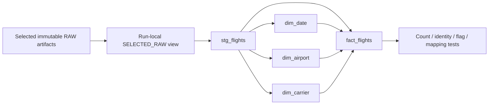

# January models and local analytics — tickets05–10

**Status: in progress, awaiting the human identity bootstrap below.** Ticket05 has
real January dbt build evidence;06's UI and09/10's grouped SQL are implemented, not
yet release-backed.07/08's control/publication/correction acceptance is not claimed.
Approved scope is January2025 plus isolated synthetic fixtures, not the final36months.
Use the existing [ingestion runbook](ingestion.md) for the accepted raw artifact.

## Local setup and commands

```bash
uv sync --locked --extra load --extra analytics
uv run --extra analytics dbt parse --project-dir dbt --profiles-dir dbt --no-partial-parse
uv run --extra analytics python -m unittest discover -s tests -v
uv run --extra analytics ruff check .
uv run --extra analytics ruff format --check .

# A new output directory is required. This creates/tests a candidate, never publishes.
uv run --extra analytics airline build --artifact /private/path/to/january-artifact \
  --output /private/path/to/new-candidate --budget-state /private/path/to/batch-budget.json \
  --funding-verified
```

The tested locked set is dbt Core1.12.6, Snowflake adapter1.12.4, connector4.8.1 and
Streamlit1.66.1 on Python3.12. No dbt Cloud/Fusion service, CI or global tool install.
The1.11 adapter's stale certificate upper bound was rejected rather than downgrade TLS.
Core includes its own parser dependency; this is not a separate Fusion execution path.

The approved batch budget is45minutes cumulative live execution and2additional
observed credits from initial account-monitor usage0.12. It is a stop limit, not a
billing cap: account metering is delayed/shared and storage is separate. Keep the same
budget ledger across continuations; never reset it to bypass a stop. X-Small, acceleration
off, auto-suspend60, statement600/queue60 and short lock timeouts remain unchanged.
Only deliberate commands run work; no watchers, automatic source discovery or scheduling.

## Warehouse build and lineage



`candidate_plan()` rejects multiple artifacts for the same month. `build_candidate()`
creates a new allowlisted `WORK_<24hex>` namespace, checks raw integrity, runs dbt with
two threads and emits `candidate.json` **only after success**. It preserves dbt
`manifest.json`, `run_results.json`, compiled SQL and logs under the private output
directory. No accepted RAW overwrite or natural-key MERGE occurs. Deterministic
critical failures remain unaccepted; timeouts/uncertain results block new live work
in the batch ledger until attended reconciliation of the exact query tag.

Five model tables are explicitly transient in a transient schema with one-day
retention; real SHOW evidence verifies table kinds/retention. Small durable control
metadata will be publisher-owned separately. Staging/fact retain all119 original
source columns plus original lineage and typed analytical fields. Technical flight
key is dataset/source-ZIP-hash/ordinal, not physical-flight uniqueness. Marketer and
operator DOT IDs and source airport sequence/codes/attributes remain on every fact.

Dimensions use stable airport/DOT IDs and deterministic selected-scope display labels;
no generalized SCD2 or current corporate-affiliation replacement. The pinned January
profile found zero airport-sequence, airport-code or DOT-code variants per stable ID.
That is one-month evidence, not a claim that historical changes never occur. Future
baseline/reference qualification remains required; original source attributes are retained.

The primary definitions remain [specification D06](specifications/airline-delay-intelligence.md#d06-metric-and-quality-contracts).
Source flags are never coalesced to successful outcomes. Optional missing delay
indicators remain disclosed exclusions. Rates derive from counts at the requested
filter/group level; exact continuous median/p90 derive from eligible signed values.
The query contract uses double-precision division, avoiding Snowflake's default
six-decimal integer-division scale; only presentation rounds values.

## Independent January evidence

The real fact population is599,013, unchanged by dimension joins. Against an independent
read of the original held archive:

| Measure | Numerator | Denominator |
| --- | ---: | ---: |
| Arrival on-time |469,352|578,957|
| Cancellation |18,740|599,013|
| Diversion |1,316|599,013|
| Departure delay |105,508|580,273|

Signed arrival count578,957, mean4.051249056492969minutes, median−8, exact p90=38.
Carrier10/month1/weekday7/scheduled-hour24/origin-airport352 grouped populations each
reconcile to599,013. DEN's165directional route groups reconcile to24,732. Initial
aggregate latency was about1.08s as the builder; this is not a restricted-reader
dashboard SLA. Actual reader cold/warm measurements await bootstrap.

Live hand-authored fixtures separately verify14/15boundaries,−10/0/14/15/60mean15.8,
median14/p9042, cancellation with departure data, diversion inclusion/exclusion,
missing indicators, zero-denominator N/A, unequal subgroup weighting, ordered routes,
scheduled versus actual crossing-hour cohorts and99/100ranking eligibility. Deliberate
missing required IDs and unknown cancellation flags fail dbt acceptance. Offline
AppTest verifies development labeling, filter→empty→reset behavior; cache identities
include account/database/target/schema/release/query contract/every filter/threshold.

Regression input containing a nonfinite signed delay and zero required airport ID
initially reproduced an acceptance bug in an isolated synthetic candidate. That
diagnostic descriptor was explicitly quarantined/unsealed and never granted or
published. The corrected critical test rejects both rows; the official and nine-row
candidates were then rebuilt successfully under the corrected processing contract.
No invalid-row filtering, source repair or official RAW mutation was used.

The latest official candidate and lineage site are outer
`.scratch/airline-delay-intelligence/batch-05-10/january-build-v2/candidate.json` and
`january-build-v2/dbt/index.html`; `build_run_results.json` preserves original test
results. Docs were generated with `--no-compile --empty-catalog`: lineage/SQL/schema
descriptions are inspectable without warehouse catalog queries, but HTML column
statistics are intentionally absent. Actual table-kind/retention evidence is separate.

## Required owner bootstrap — do not broaden the existing builder

The agent cannot CREATE ROLE/USER or transfer CONTROL ownership. The exact rendered
script is outer `.scratch/airline-delay-intelligence/batch-05-10/owner-bootstrap.sql`.
It contains public keys only, rendered from `sql/05_analytics_roles.sql`. In the human
ACCOUNTADMIN worksheet, first confirm accountDC50202/AWS_US_EAST_2, then execute that
script in order. Stop at the first error; inspect existing objects rather than replace
them or blindly rerun CREATE statements.

It creates separate SERVICE users/roles AIRLINE_PUBLISHER and AIRLINE_READER, a
publisher-owned CONTROL schema, project-database schema-creation rights for snapshots,
warehouse/database usage and publisher-only monitor visibility. Reader has no base
table SELECT, write rights or role inheritance. No global MANAGE GRANTS, ACCOUNTADMIN
workload grant, AWS permission changes or existing user/key replacement.

Separate private keys are protected0600 under `~/.snowflake/airline-analytics/`, outside
both repositories; existing key/config is unchanged. Never put keys/passphrases into
SQL, command arguments, Git, scratch notes or logs. No private key was copied into the
rendered script. Exact candidate SELECT/USAGE is granted by its existing builder owner,
not by administrative fallback.07 must revoke development-reader candidate access
before adopting released-only reads and prove actual negative permissions.

## Development dashboard (after owner bootstrap and exact read grants)

```bash
AIRLINE_DEVELOPMENT_CANDIDATE=/private/path/to/candidate.json \
  uv run --extra analytics streamlit run app.py --server.address 127.0.0.1
```

The app uses AIRLINE_READER only, never builder/publisher credentials as fallback.
Project Streamlit configuration binds loopback, disables telemetry and hides exception
details. Only bounded aggregate results (up to500groups), not national flights, enter
pandas. Date/carrier/stable-ID origin/destination filters, reset, explicit applied
summary, counts/exclusions, signed summaries and metric-specific ranking flags are
implemented. Raw-field browsing, exports and public hosting are not implemented.

Development requires the explicit descriptor path and displays UNPUBLISHED. Default
released mode remains unavailable until07's real protocol is installed/tested; no
invented validated-release metadata or mixed fallback. Analytical cache TTL900s,
filter-options TTL15s; descriptor remains pinned across all queries within a render.
Actual expiration/publication-race behavior awaits07, not merely the offline cache test.
