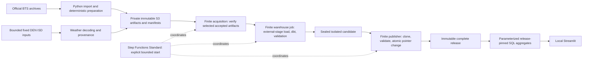
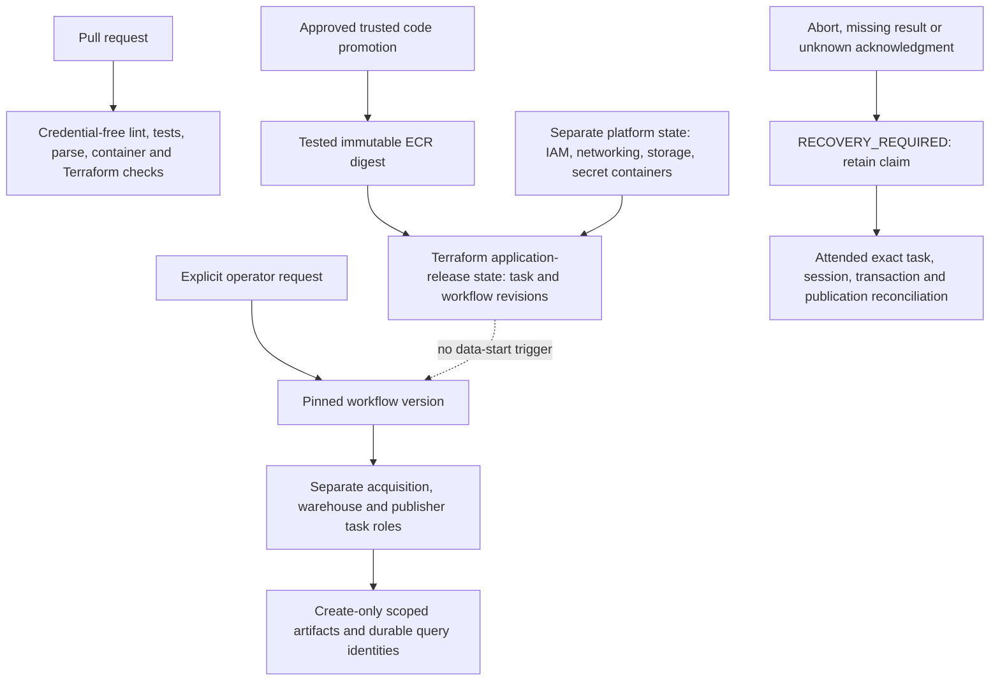

# Airline Delay Intelligence — presentation guide

**Status: prepared for the owner walkthrough; final platform acceptance pending.**
No cleanup, credential retirement or infrastructure deletion is authorized by this
document. The working application requires Snowflake; preserved evidence is not an
offline replacement warehouse or dashboard.

## The story in ten minutes

1. **Question and scope (one minute).** Explain historical airline reliability,
   not prediction or causation. Coverage is January 2023–December 2025: 36 months,
   22,562,477 reported scheduled-operation rows. One source row is not necessarily
   one distinct aircraft movement or passenger journey.
2. **Traceability (two minutes).** Walk from original ZIP hash through deterministic
   prepared gzip, accepted RAW identity, selected monthly map, dbt candidate and
   frozen release. Show why repacked preparation and source corrections have
   separate identities. See [ingestion](ingestion.md) and [baseline](baseline.md).
3. **Dashboard (three minutes).** Open the existing local dashboard, show the pinned
   release and historical coverage, filter carrier/date/origin, compare opposite
   route directions, then reset. Show rates with eligible counts, signed delay
   mean/median/p90, reported category minutes and recovery. Explain why subgroup
   percentages and percentiles cannot simply be averaged.
4. **Weather (one minute).** Drill into fixed DEN/local-January 2025. All 24,732
   scheduled rows, including 313 cancellations and 69 diversions, remain in the
   denominator. Temperature/wind/visibility match independently backward by at most
   60 minutes. Show coverage and date concentration, not a causal weather effect.
   See [weather](weather.md).
5. **Failure safety (two minutes).** Explain the lock-first control transaction,
   immutable frozen data, single pinned reader descriptor and retained previous
   release. Contrast a failed required stage with a committed publication whose
   final status write failed. Show actual qualified evidence rather than inducing
   a live failure during the presentation.
6. **Infrastructure and costs (one minute).** Show separate deploy and refresh paths,
   finite tasks, no service/schedule/ingress/NAT, scoped identities and retained
   versions. State the remaining qualification gaps honestly. Credits, monitoring
   and timeouts are safeguards, not a guaranteed hard cash cap.

## Data and execution diagram

## Trust and deployment diagram

The trusted-promotion/OIDC path remains subject to actual repository protection and
permission qualification; a diagram is not evidence that those controls are live.

## Preserve before trial expiry

Use sanitized evidence already captured during qualification, bound to code, image,
workflow, source and release identities. Include:

- Source/manifest checksums and exact monthly row reconciliation, not raw archives.
- Independent KPI/quantile/category/recovery and weather coverage summaries.
- Normal refresh, exact replay and failure/recovery outcomes with terminal states.
- dbt model/test lineage, Terraform ownership inventory and clean-plan summaries.
- CI run links and actual deployment/no-data-trigger evidence when qualified.
- Dashboard views showing release, filter scope, denominators and weather limits.
- Funding/expiry/cost observations clearly separated from estimates and guarantees.

Never publish keys, tokens, signed URLs, connection configuration, raw state,
binary plans, raw samples or unsanitized console/log exports. Keep operational
evidence outside Git; only reviewed summaries and presentation material belong here.

## Questions the owner should be able to answer

- What is a scheduled row, and which rows are eligible for each measure?
- How do an identical replay, a changed preparation and a corrected month differ?
- Why use transient isolated candidates and frozen release-local relations?
- Why does task termination not prove SQL/transaction termination?
- What happens if publication commits but the workflow later fails?
- Which identities can load, publish, read, deploy and recover—and which cannot?
- What remains after cleanup is proposed but not approved?

The [cleanup plan](cleanup-plan.md) inventories retained responsibilities and gates.
The [cloud qualification status](cloud-jobs.md) records current implementation
evidence and unmet outcomes; it must not be replaced by presentation claims.
