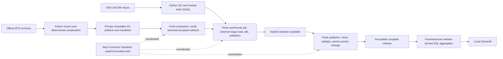
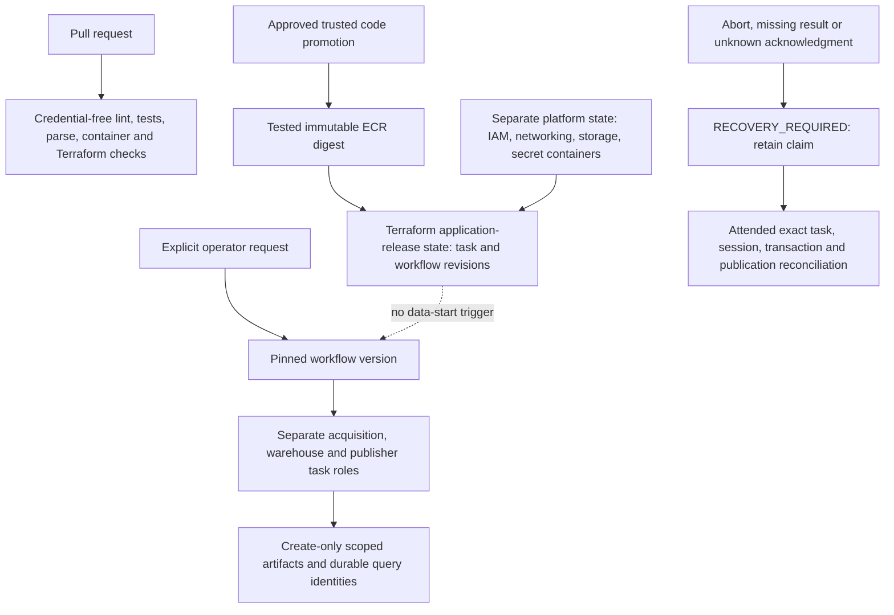

# Airline Delay Intelligence — presentation guide

**Architecture walkthrough, updated 2026-11-14.** Explain the implemented design
using diagrams and dated evidence. The [resource lifecycle](resource-lifecycle.md)
records removed infrastructure and remaining owner actions; live console links and
dashboard availability must not be assumed. Preserved evidence is not an offline
replacement warehouse or dashboard.

Use the [latest sanitized delivery summary](evidence/delivery-qualification.json)
and [initial data/recovery snapshot](evidence/qualification-summary.json) for dated
measured results. The earlier snapshot's GitHub/tooling prerequisites have since
been resolved; neither file is live status or owner acceptance.

The [November 4 owner-import evidence](evidence/snowflake-importer-bootstrap.json)
adds all three existing SERVICE users to protected Terraform state: fifteen Snowflake
instances, zero object changes, official-plugin normal plan clean. Read-only account
monitor verification passed. Disclose the unsupported attachment coverage and the
refresh-only last-login metadata exception; neither is silently waived.

## Diagram-led walkthrough

Use the diagram as the main screen. Briefly show Snowflake's database/schema
organization or the fact/dimension model, then return to the architecture. When an
authorized live environment exists, demonstrate one overview KPI and a period
filter, then one weather-band rate. Otherwise use clearly dated, sanitized evidence.
There is no need to tour every console or dashboard section. GitHub/AWS browsing is
optional; never start new processing merely to demonstrate the graph.

Suggested topics, shortened or expanded to match the audience:

1. **Question and scope (one minute).** Explain historical airline reliability,
   not prediction or causation. Coverage is January 2023–December 2025: 36 months,
   22,562,477 reported scheduled-operation rows. One source row is not necessarily
   one distinct aircraft movement or passenger journey.
2. **Traceability (two minutes).** Walk from original ZIP hash through deterministic
   prepared gzip, accepted RAW identity, selected monthly map, dbt candidate and
   frozen release. Show why repacked preparation and source corrections have
   separate identities. See [ingestion](ingestion.md) and [baseline](baseline.md).
3. **Dashboard.** Introduce the four investigations: Network & carriers, Time &
   routes, Disruption & recovery, and DEN weather. Snowflake computes filtered SQL
   aggregates and Streamlit displays them; cached results can be reused, so every
   click is not necessarily fresh compute. See [dashboard guide](dashboard-guide.md).
4. **Weather.** The published GHCNh extension covers 930,445 DEN schedules throughout
   2023–2025, including cancellations and diversions. Temperature/wind/visibility
   independently match backward by at most 60 minutes. Show one compact comparison
   and matching-coverage caption, not a causal weather effect. Airport/station
   identity and source quality need airport-specific validation; coverage is Denver
   only. The earlier January ISD pilot remains historical evidence, not the latest
   weather scope. See [full-period evidence](weather-2023-2025.md).
5. **Failure safety (two minutes).** Explain the lock-first control transaction,
   immutable frozen data, single pinned reader descriptor and retained previous
   release. Contrast a failed required stage with a committed publication whose
   final status write failed. Show actual qualified evidence rather than inducing
   a live failure during the presentation.
6. **Infrastructure and costs (one minute).** Show separate deploy and refresh paths,
   finite tasks, no service/schedule/ingress/NAT, scoped identities and retained
   versions. State the remaining qualification gaps honestly. Credits, monitoring
   and timeouts are safeguards, not a guaranteed hard cash cap.

## Data and execution diagram

The solid graph is the logical data path. The current GHCNh extension used local
execution of shared build/publication code. The qualified cloud adapter admits
isolated targets and the original ISD transport, not the full-period GHCNh payload.
Publisher admission precedes acquisition; exact-input replay can exit early without
another build. Fargate tasks have outbound public IPs and no inbound service; this
is not a fully private-subnet/PrivateLink architecture.

## Trust and deployment diagram

The trusted-promotion/OIDC path was qualified through the actual protected release
workflow; [delivery evidence](delivery.md) records allowed/denied trust, promotion,
overlap and rollback/recovery. That delivery is now disabled and its runtime
dependencies removed as recorded in resource lifecycle. The diagram alone is not
the evidence or current cloud inventory.

## Preserve before trial expiry

Use sanitized evidence already captured during qualification, bound to code, image,
workflow, source and release identities. Include:

- Source/manifest checksums and exact monthly row reconciliation, not raw archives.
- Independent KPI/quantile/category/recovery and weather coverage summaries.
- Normal refresh, exact replay and failure/recovery outcomes with terminal states.
- dbt model/test lineage, Terraform ownership inventory and clean-plan summaries.
- CI run links and actual deployment/no-data-trigger evidence when qualified.
- Dashboard views showing release, filter scope, denominators and weather limits.
- Funding/expiry/cost observations clearly separated from estimates and guarantees.

Never publish keys, tokens, signed URLs, connection configuration, raw state,
binary plans, raw samples or unsanitized console/log exports. Keep operational
evidence outside Git; only reviewed summaries and presentation material belong here.

## Questions the owner should be able to answer

- What is a scheduled row, and which rows are eligible for each measure?
- How do an identical replay, a changed preparation and a corrected month differ?
- Why use transient isolated candidates and frozen release-local relations?
- Why does task termination not prove SQL/transaction termination?
- What happens if publication commits but the workflow later fails?
- Which identities can load, publish, read, deploy and recover—and which cannot?
- Which resources remain after teardown, and what owner permissions are required?

The [cleanup plan](cleanup-plan.md) inventories retained responsibilities and gates.
The [cloud qualification status](cloud-jobs.md) records current implementation
evidence and unmet outcomes; it must not be replaced by presentation claims.
